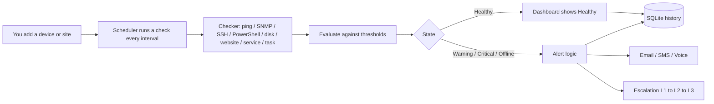
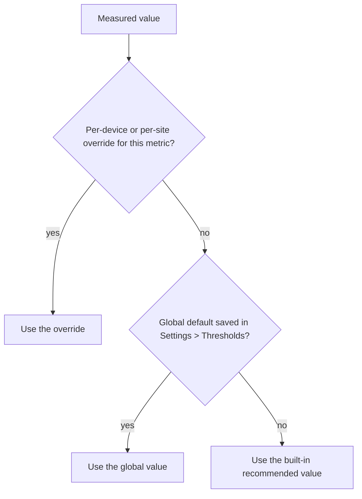
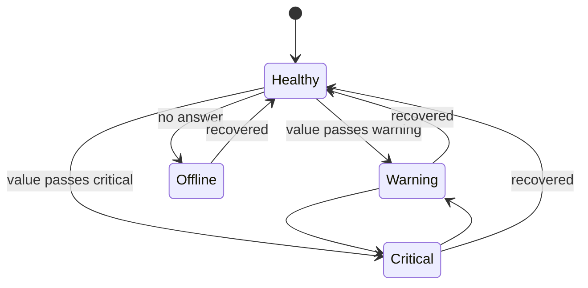
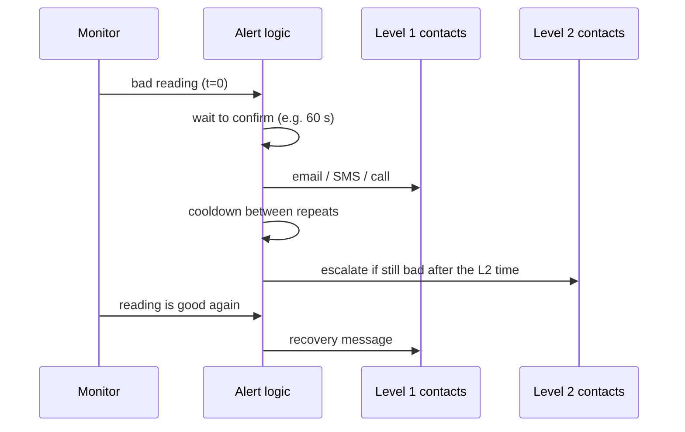
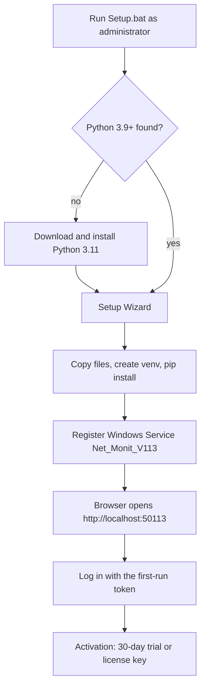
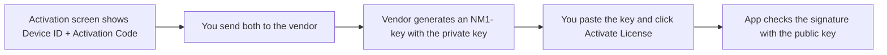

# Net-monit V11.3 — How the app works, start to finish

GitHub draws the diagrams below automatically. Words in **bold** are the names you see on screen.

## 1. The big picture

1. **Add:** Devices page (network, server, PowerShell host) or Sites page (website). Network Scan can add many at once.
2. **Check:** the scheduler (APScheduler) runs each monitor at its own interval (30 s by default). Each method has its own checker in `monitor/checkers/`.
3. **Evaluate:** each measured value is compared with a Warning and a Critical threshold.
4. **Record:** every result is saved in SQLite (`data/monitor.db`); old data is purged on a schedule.
5. **Alert:** only when the state is bad *and* the timing rules below say it is time.

## 2. Which threshold wins

- Higher is worse for everything except **SSL certificate expires in (days)**, where lower is worse (warning 30, critical 7).
- **Apply to all devices / Apply to all sites** (Settings > Thresholds) saves the table as the default and removes the overrides of those metrics.
- The **!** next to a metric shows its meaning, allowed range and recommended values.

## 3. From a bad reading to an email

Two timers decide when you are told:

| Setting | Where | What it does |
|---|---|---|
| **Alert trigger mode** | Settings > Escalation, or a monitor's **Notify** window | *Immediate*: alert at the first bad reading. *Wait to confirm*: alert only if the problem lasts the number of **wait seconds**. |
| **Repeat-alert cooldown** | same place | *Immediate*: no extra gap. *Cooldown*: at least N seconds between repeat alerts for the same problem. |

A per-metric **Wait** (in the Notify window) beats the monitor's Level 1 time. **Apply wait & cooldown to: All devices & sites / Devices only / Sites only** copies the on-screen values to those monitors; it changes only these timing fields.

## 4. Install workflow

Linux: `sudo bash setup.sh` does the same with a systemd service `netmonit-v113`. Manual run: `python app.py` (see `DOC-Setup-Python-Manual.md`).

## 5. License workflow

The app only **verifies** keys. Signing needs a private key that never leaves the vendor.

## 6. Upgrade workflow
Each version has its own folder, port and service name. Install the new one next to the old one, check it, then remove the old service. Steps: `DOC-Setup-Guide.md`, section "Upgrading".

## 7. Pages and what they are for
| Page | Use it to |
|---|---|
| Dashboard | See every monitor's state now |
| Devices | Add and edit devices; open **Notify** for contacts, thresholds, timing |
| Sites | Websites: response time, SSL days left, DNS/connect/handshake timing |
| Network Scan | Find devices on a subnet (ping, TCP, UDP) |
| Speed Test | WAN and browser speed tests |
| Alerts | History of alerts and recoveries |
| Settings | SMTP, thresholds, escalation, templates, monitors |
| Admin | Users, license, audit log, about |
